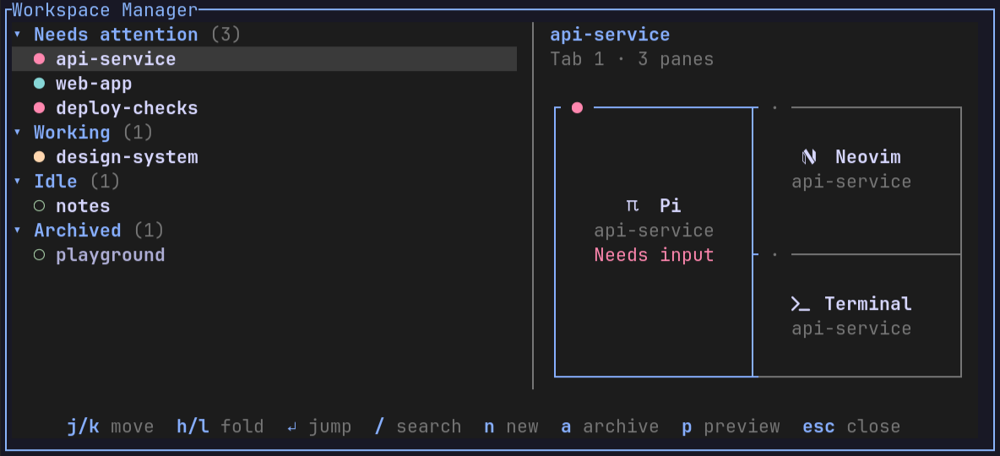
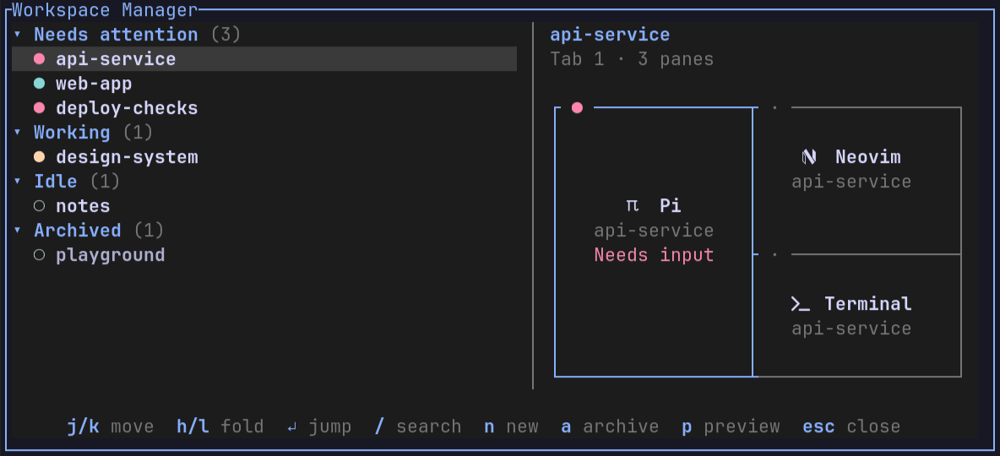
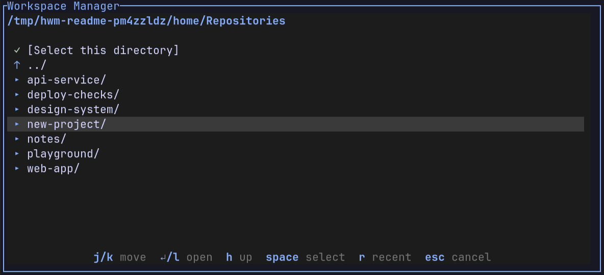

# herdr-workspace-manager

A compact, keyboard-driven workspace picker for Herdr.

## Usage

Open with **`prefix+space`**, or run `herdr-workspace-manager` inside Herdr.



Preview apps and pane layouts without switching focus or reading terminal contents. Colors follow your Herdr theme; use a Nerd Font for app icons.

### Every state



Sample environments: **input needed → result ready → failed → working → idle → archived**.

### Keys

| Key | Action |
| --- | --- |
| `j` / `k` | Move up/down |
| `h` / `l` | Collapse/expand groups |
| `Enter` | Jump to the workspace’s relevant pane |
| `Esc` | Cancel or close |
| `/` | Search |
| `n` | Create a workspace |
| `a` | Archive/unarchive |
| `d` | Delete an archived workspace (with confirmation) |
| `p` | Hide/show the layout preview |

- **Review:** focus a completed agent's pane to mark it reviewed. Opening the picker does not clear attention; input/approval requests stay pending until resolved.
- **Archive:** processes keep running. New attention brings the workspace back; working activity alone does not.
- **Delete:** on an archived workspace, press `d`, then `y`. This stops its processes. Enter or Esc cancels, as does new attention during confirmation.

### Create a workspace



`n` → browse with `j/k`, `↵/l`, and `h` → `Space` to select → edit the name → `Enter` to create and jump. `r` shows recent directories; Esc cancels.

## Install

From this checkout:

```sh
mkdir -p "$HOME/.local/bin"
ln -s "$PWD/bin/herdr-workspace-manager" "$HOME/.local/bin/herdr-workspace-manager"
herdr plugin link "$PWD"
```

Back up your Herdr config before editing:

```sh
config="${HERDR_CONFIG_PATH:-$HOME/.config/herdr/config.toml}"
cp -a "$config" "$config.bak.$(date +%Y%m%d-%H%M%S)"
```

Keep your existing Herdr prefix and add this binding:

```toml
[[keys.command]]
key = "prefix+space"
type = "plugin_action"
command = "herdr-workspace-manager.open"
```

Apply with `herdr config check` and `herdr server reload-config`. The popup is titled **Workspace Manager** and scales to 50% of the screen width and 45% of its height. Adjust these percentages in `herdr-plugin.toml`, then run `herdr plugin link "$PWD"` again.

### Track activity while the picker is closed

Install the background observer:

```sh
mkdir -p "$HOME/.config/systemd/user"
cp contrib/herdr-workspace-manager-watch.service "$HOME/.config/systemd/user/"
systemctl --user daemon-reload
systemctl --user enable --now herdr-workspace-manager-watch.service
```

The included service targets the default local Herdr session. For another socket, update its `HERDR_SOCKET_PATH` to match the attached session before enabling it. After updating this checkout, restart the observer with `systemctl --user restart herdr-workspace-manager-watch.service`.

## Current limitations

- Older Herdr servers can miss completions that occur entirely between activity checks.
- Failures require explicit reporting: `herdr-workspace-manager --report-failure "$HERDR_PANE_ID" --message 'Description'`. Resolve with `--clear-failure "$HERDR_PANE_ID"`.
- Archive and review state survives picker restarts, but resets when the Herdr server is replaced or restarted.

## Remove

Remove the picker's `[[keys.command]]` block and reload Herdr's config. Then remove the observer and launcher:

```sh
herdr plugin unlink herdr-workspace-manager
systemctl --user disable --now herdr-workspace-manager-watch.service
rm "$HOME/.config/systemd/user/herdr-workspace-manager-watch.service"
systemctl --user daemon-reload
rm "$HOME/.local/bin/herdr-workspace-manager"
```

Optional: delete `${XDG_STATE_HOME:-~/.local/state}/herdr-workspace-manager` to clear saved archive/review state and recent directories. Existing workspaces are unaffected.
